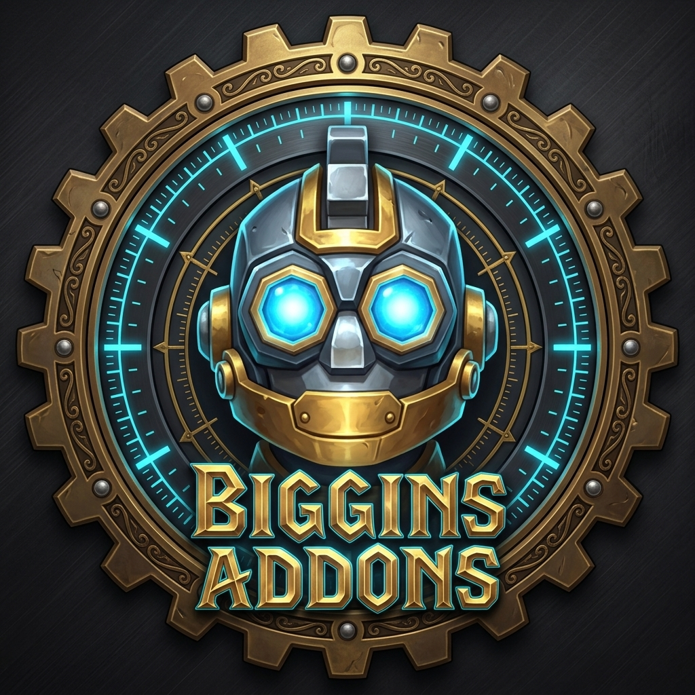

# Biggins AddOns

<p align="center">
  
</p>

Welcome to the **Biggins AddOns** suite for *World of Warcraft* (Midnight & The War Within).

This repository houses a collection of performance-focused addons and custom tools built with a strict emphasis on **zero-allocation programming, CPU efficiency, native Blizzard UI integration, and cohesive aesthetic design**.

All projects here are open source and shared freely under the [MIT License](LICENSE) for the community to use, fork, or incorporate into upstream projects. All addons in the suite are available for download on [CurseForge](https://www.curseforge.com/members/biggins_whisperwind/projects).

---

## Projects in this Repository

### 1. [AutoJoin Biggins (v1.2.0)](./autojoin-biggins)
A lightweight, configurable auto-accept utility for party invitations from Guildmates, Character Friends, and Battle.net contacts.
* **Granular Invite Filters:** Independent toggles for Guild, Friends, Battle.net, and All Players (with safety warning).
* **Automatic Chat Channel Priming:** Automatically prepares active chat input to `/p` (Party), `/ra` (Raid), or `/i` (Instance) upon joining.
* **Blizzard Dialog Suppression:** Eliminates intrusive invitation popup dialogs.
* **Modern Canvas Settings UI:** Integrated under `Options -> AddOns -> Biggins AddOns -> AutoJoin` with top-right `[ Defaults ]` button and dynamic control graying out.

### 2. [LazySpeed Biggins (v3.8.0)](./lazyspeed-biggins)
A high-performance flight, swim, and movement speedometer featuring a sleek nameplate-style HUD, dynamic color gradients, and zero Lua garbage generation.
* **Nameplate-Style Integrated HUD:** Compact status bar with high-contrast centered telemetry overlaid directly on the dynamic fill bar.
* **Percentage Default Unit:** Defaults to percentage (`%`) of base run speed, with clean radio button support for MPH, y/s, and km/h.
* **Granular Visibility & Lock Controls:** Modular checkboxes for Flying/Skyriding, Swimming, Ground, Combat Hide, and Frame Lock.
* **Screen Position Persistence:** Drag with left-click when unlocked, save position across sessions, and reset anytime via `[ Reset Position ]` or `/lazyspeed reset`.
* **Zero Idle Footprint:** Completely unhooks its update script (`OnUpdate = nil`) when grounded or dormant for a verified `0.00ms` CPU footprint.

### 3. [Perf Biggins (v1.2.0)](./perf-biggins)
A high-performance tri-bar telemetry HUD displaying real-time FPS, World Latency, and Home Latency in a unified nameplate stack.
* **Tri-Bar Split Nameplate Stack:** Three individual status bars separated by a clean air gap, styled with dark slate tooltip backdrops and Blizzard Metallic Gold borders.
* **Native Game Engine Keybinding:** First-class `Bindings.xml` integration under `Keybindings -> AddOns -> Perf Biggins` to instantly toggle HUD visibility.
* **Unified Drag Movement:** Dragging any visible bar moves the entire stack as a single locked unit.
* **Dynamic Collapse:** Seamlessly collapses and resizes if any individual bar is toggled off.
* **Zero Garbage Generation:** Uses Blizzard's native C++ `FontString:SetFormattedText()` with pre-cached static format string pointers.
* **Modern Canvas Settings UI:** Granular width/height sliders, lock toggle, combat hide, and position reset.

### 4. [SummonPet Biggins (v1.2.0)](./summonpet-biggins)
An ultra-lightweight, event-driven companion pet summoner designed to keep your favorite companion pet summoned automatically without CPU stutter or memory bloat.
* **0.00% Movement CPU Usage:** Purely event-driven lifecycles triggered on dismount, stealth exit, combat drop, or zone transitions.
* **Native Game Engine Keybinding:** First-class `Bindings.xml` integration under `Keybindings -> AddOns -> SummonPet Biggins`.
* **1-Click Pet Pinning:** Click `[ Use Currently Summoned Pet ]` or type `/spb pin` to permanently pin your favorite companion.
* **Multi-Tier Instance Auto-Dismiss:** Granular hierarchy for Raids, Mythic+ Dungeons, Regular Dungeons, and Delves & Labyrinths.
* **Modern Canvas Settings UI:** Multi-tier nested hierarchy with top-level master toggle and top-right `[ Defaults ]` button.

### 5. [SafeRelease Biggins (v1.0.0)](./saferelease-biggins)
An ultra-lightweight group safety utility designed to guard the "Release Spirit" button during wipes across raids, Mythic+ dungeons, and delves to prevent accidental and costly releases.
* **Physical Click Interception:** Places an inert overlay button directly over the native Release button during lockouts, making early release physically impossible even with high-frequency mouse spam.
* **3 Flexible Guard Modes:** Configurable for Countdown Timer Delay (1-10s), Modifier-Key Hold (Alt/Shift/Ctrl), or Hybrid Mode (countdown with instant modifier bypass).
* **Full Raid Wipe Detection:** Automatically detects when the entire raid group is dead and immediately unlocks release for the run-back.
* **Usable Self-Resurrection Bypass:** Automatically leaves the dialog unblocked if a Shaman Reincarnation, Warlock Soulstone, or other self-rez option is ready.
* **Modular Content Scoping:** Independent toggles for Raids (Default: ON), Mythic+ Dungeons, Regular Dungeons, and Delves & Scenarios. Never blocks release in open world or PvP.
* **Modern Canvas Settings UI:** Integrated under `Options -> AddOns -> Biggins AddOns -> SafeRelease` with top-right `[ Defaults ]` button and master toggle.

### 6. [ChatLink Biggins (v1.0.0)](./chatlink-biggins)
An ultra-lightweight chat utility designed to make web URLs in chat clickable for instant, native copy-pasting (`Ctrl+C` -> `Enter`).
* **100% Blizzard Factory Aesthetic:** Uses native `StaticPopupDialogs` with auto-highlighted text and instant focus. No custom skins or third-party frameworks.
* **Single-Pattern Protocol Isolation:** Strict protocol matching for `https://` and `http://` eliminating pattern collisions, domain whitelists, and chat loops.
* **Sentence Punctuation Stripping:** Automatically trims trailing punctuation (`.,;:!?)[]'"`) so links copied at sentence boundaries remain clean and valid.
* **Pipe Escape Protection:** Safely respects WoW `|` escape sequences, protecting adjacent item links, spell links, and player names.
* **Modern Canvas Settings UI:** Integrated under `Options -> AddOns -> Biggins AddOns -> ChatLink` with top-right `[ Defaults ]` button and master toggle.

---

## Unified In-Game Settings (`Biggins AddOns`)

All six addons automatically register under a unified parent category in the native Blizzard settings menu (`Escape -> Options -> AddOns`):

```text
[-] Biggins AddOns
    AutoJoin
    ChatLink
    LazySpeed
    Perf
    SafeRelease
    SummonPet
```

* **Parent Landing Page:** Clicking `Biggins AddOns` presents the suite overview, character portrait, and quick-jump navigation buttons to each installed addon.
* **Independent & Decoupled:** Each addon operates as a completely standalone download; the suite category seamlessly adapts to whichever Biggins addons are installed.

---

## Performance & Engineering Philosophy

Many legacy addons suffer from continuous frame polling, dynamic string concatenation (`..`) in tick loops, and unthrottled texture redraws that contribute to frame hitches, Lua garbage collection spikes, and client lockups.

The addons in this repository adhere to the following standards:

1. **Zero-Allocation in Hot Paths:** Eliminate table creations, closures, and string concatenations inside frequent update loops.
2. **Event-Driven Lifecycles:** Avoid per-frame polling whenever game events can manage state transitions.
3. **Hard Script Detachment:** Unhook `OnUpdate` scripts entirely (`SetScript("OnUpdate", nil)`) when UI components are dormant.
4. **Native Blizzard Ecosystem:** Leverage modern Blizzard C-APIs (`Settings.RegisterCanvasLayoutCategory`, `Settings.RegisterCanvasLayoutSubcategory`, `FontString:SetFormattedText`) for clean visual integration and seamless persistence.

---

## Shared Architecture & LibBigginsSuite

The shared parent settings logic and suite branding are maintained in a canonical Single Source of Truth directory:
* [`lib-biggins-suite/`](./lib-biggins-suite) - Contains the master `LibBigginsSuite.lua` and `suite-logo.jpg`.
* [`sync-suite.ps1`](./sync-suite.ps1) - One-command deployment directly from the canonical library to the local WoW Retail client.
* **Zero Duplication & Zero Dependencies:** Addon source folders in the repository remain completely free of duplicate library files. When building release archives via `package.ps1`, the latest library files are automatically bundled into each package, keeping every Biggins addon completely self-contained for CurseForge and Wago players.

---

## License

This repository is licensed under the [MIT License](LICENSE) - feel free to use, modify, distribute, or incorporate any of this code into your own projects.
